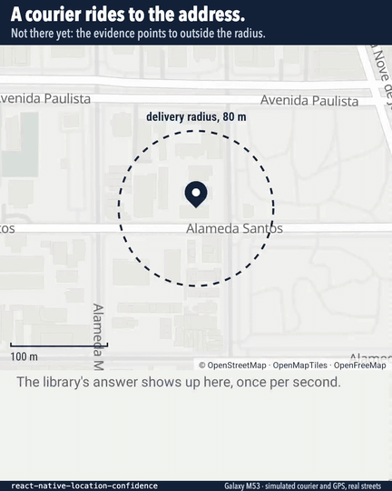

# react-native-location-confidence

Tells how good the location evidence is for one question: **"is this phone inside the delivery radius of this address?"**

Instead of yes or no, it answers with a report:

- an **index from 0 to 100** that says how good the evidence is (not a percentage);
- what the evidence points to: **inside** the radius, **outside**, or **it cannot take a side**;
- the **reasons**, as short fixed codes.

<p>
  
</p>

A courier rides to the address and parks. Then one GPS reading lands 340 m away: the library leaves it out, and the index drops from 97 to 60 before it goes back to 97. Recorded on an Android phone from the example app, which plays a made-up courier and made-up GPS readings against the real engine, on a real street map. [More videos and screenshots](https://github.com/gustavo-em/react-native-location-confidence/tree/main/docs/demo).

## Quick start

```sh
npm install react-native-location-confidence
cd ios && pod install
```

```ts
import { LocationConfidence } from 'react-native-location-confidence';

// Your app decides when to ask the user. Nothing else shows a dialog.
await LocationConfidence.requestLocationPermission();

const report = await LocationConfidence.getProximityReport({
  destination: { latitude: -23.55052, longitude: -46.633308 },
  radiusMeters: 100,
});

report.evidenceRelation; // 'supports_inside' | 'supports_outside' | 'inconclusive'
report.qualityScore; // 0 to 100: how good the evidence is. Not a percentage.
report.diagnostics.reasonCodes; // why, for example ['initial_fix_timeout', 'location_stale']
```

The call turns the GPS on, waits for a good reading, turns the GPS off and answers. It always answers, once, in 12 seconds at most (the default limit). A slow GPS is not an error: it is a report with a lower index and the reason.

Three things must be in place first:

1. The app uses React Native's New Architecture (the default in current versions).
2. Android: `ACCESS_FINE_LOCATION` and `ACCESS_COARSE_LOCATION` in the manifest. iOS: `NSLocationWhenInUseUsageDescription` in `Info.plist`. See [Permissions](#permissions).
3. The app was rebuilt after installing. Expo Go cannot load the library.

Sessions, cancelling, every option and every field of the report are in the [guide](https://github.com/gustavo-em/react-native-location-confidence/blob/main/docs/GUIDE.md).

## What it looks at

A delivery app usually compares the last GPS reading with the address and stops there. That reading may be 40 seconds old, may be 200 m off, may be a one-second GPS glitch, or may come from a fake-GPS app. This library looks at those things:

- **It waits in steps.** A first attempt, then some extra time, and a limit for the whole request. When the GPS stays silent it answers with the last reading it remembers.
- **It knows an old reading is worth less.** It works out how far the phone could have moved since the reading. If the phone reports that it is standing still, the reading stays useful for much longer.
- **It notices what does not fit.** A reading that lands 340 m away from the others in one second is not used. A reading the system marks as simulated brings the index to 0.

One engine, written in C++, runs behind a Kotlin layer on Android and a Swift layer on iOS, so both platforms give the same answer.

## What it is not

- **The index is not a percentage and not a probability.** `qualityScore: 78` does not mean "78% sure". Never show it with a `%` sign.
- **It is not proof of presence.** "Evidence supports inside" means the GPS evidence is compatible with the phone being there. It does not prove a person was at the door.
- **It does not approve or refuse anything.** Your app decides what to do with the report, for example ask for a photo or a code when the evidence is weak.
- **It is not fraud detection.** It reports when the system marks a location as simulated. A location that is not marked proves nothing.
- **It does not work in the background.** When the app leaves the screen, whatever was running ends.

The numbers behind the index (weights, speeds, limits) are design choices, not calibrated measurements. They are all listed in the [guide](https://github.com/gustavo-em/react-native-location-confidence/blob/main/docs/GUIDE.md#how-the-answer-is-built).

## How it compares with other location libraries

It does not replace them. They give your app positions. This library answers one question about a position.

| Library | Made for | Judges the evidence for an address? |
|---|---|---|
| [`expo-location`](https://www.npmjs.com/package/expo-location) | Positions once or continuously, background tasks, circular geofences | No. It delivers positions and enter and exit events. |
| [`@react-native-community/geolocation`](https://www.npmjs.com/package/@react-native-community/geolocation) | Positions once or continuously | No. When the timeout passes, the request fails with `TIMEOUT`. |
| [`react-native-geolocation-service`](https://www.npmjs.com/package/react-native-geolocation-service) | Positions once or continuously, through Google's fused provider | No. When the timeout passes, the request fails with `TIMEOUT`. |
| [`react-native-background-geolocation`](https://www.npmjs.com/package/react-native-background-geolocation) | Tracking in the background, geofences, activity recognition | Not for a check on demand. It filters bad samples while tracking. |
| [`react-native-get-location`](https://www.npmjs.com/package/react-native-get-location) | One position | No. When the timeout passes, the request fails with `TIMEOUT`. |
| **`react-native-location-confidence`** | One answer: how good is the evidence that the phone is inside this radius? | Yes. That is all it does. |

Those libraries are mature and used by many apps. This one is version 0.1.0. So far it has run on an emulator, a simulator and two physical Android phones, with the real GPS on one of them. If you need positions on a map, tracking, or background location, use one of them. The [full comparison](https://github.com/gustavo-em/react-native-location-confidence/blob/main/docs/COMPARISON.md) has the details and the sources.

## Compatibility

Only what was really built and run is listed.

| | Built and run with |
|---|---|
| React Native | 0.88.1, New Architecture (TurboModule). The old architecture is not supported. |
| Android | compileSdk 36, minSdk 24, ABIs `arm64-v8a`, `armeabi-v7a` and `x86_64`. Run on an Android 17 emulator (arm64), debug and release (R8 on). |
| iOS | Xcode 26.1.1, deployment target 15.1 (React Native's minimum). Run on the iOS 26.1 Simulator, debug and release. |
| Physical devices | Two Android phones so far, both with the release build. A Samsung Galaxy J6 (Android 10, 32-bit ARM), on 18 November 2026: indoors and standing still, three reports with the real GPS came out as designed. A Samsung Galaxy M53 (Android 14, 64-bit ARM), on 21 November 2026: only the six simulated situations of the example app, with no real GPS reading. Not tested yet: outdoors, a GPS that stays silent, approximate permission, a fake-GPS app. No physical iPhone yet. |

Expo Go is not supported: the library has native code, so it needs a development build (or any app you compile yourself).

On Android the phone's activity (standing still, walking...) is not read in this version. On iOS it comes from Core Motion.

## Permissions

The library never asks for a permission by itself. The dialog appears only when your app calls `requestLocationPermission()` (or `requestMotionPermission()`).

**Android.** The library declares no permission. Add both to your app's `AndroidManifest.xml`:

```xml
<uses-permission android:name="android.permission.ACCESS_FINE_LOCATION" />
<uses-permission android:name="android.permission.ACCESS_COARSE_LOCATION" />
```

Since Android 12 the user chooses between the precise location and an approximate one, and an app must ask for the two together. With only the approximate one the system blurs every reading on purpose (about 2 km of error), and the index never goes above 30. Do not add `ACCESS_BACKGROUND_LOCATION`: the library does not use it. Google Play services must be present.

**iOS.** Add to `Info.plist`:

```xml
<key>NSLocationWhenInUseUsageDescription</key>
<string>Say here why your app needs the location.</string>
<key>NSMotionUsageDescription</key>
<string>Say here why your app reads the phone's movement.</string>
```

`NSMotionUsageDescription` is only needed if you want the phone's activity to be used. The library asks for "when in use" only, never for "always".

## Privacy

- No network. The library sends nothing anywhere.
- No storage. Readings live in memory only, at most 10 per session, and are forgotten when the session is stopped or the app closes.
- No logs with coordinates, and reason codes never contain coordinates.
- The iOS pod ships a privacy manifest (`PrivacyInfo.xcprivacy`).

## Documentation

- [Guide](https://github.com/gustavo-em/react-native-location-confidence/blob/main/docs/GUIDE.md): sessions, cancelling, options, the fields of the report, errors, how the answer is built, reason codes, simulation for demos and tests, platform notes, troubleshooting.
- [Comparison with other location libraries](https://github.com/gustavo-em/react-native-location-confidence/blob/main/docs/COMPARISON.md).
- [Example app](https://github.com/gustavo-em/react-native-location-confidence/tree/main/example): a simulator of delivery situations and a screen for the real GPS, in English and in Portuguese.
- [Demo videos](https://github.com/gustavo-em/react-native-location-confidence/tree/main/docs/demo).
- [Changelog](https://github.com/gustavo-em/react-native-location-confidence/blob/main/CHANGELOG.md).

## License

MIT
