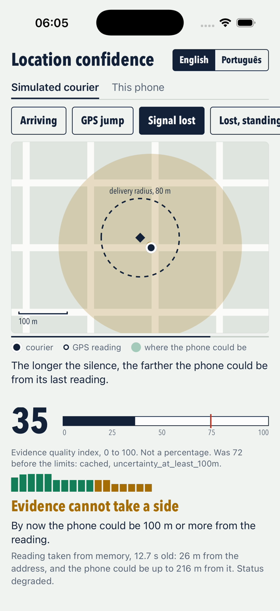
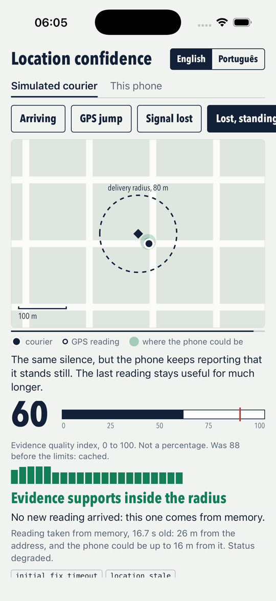
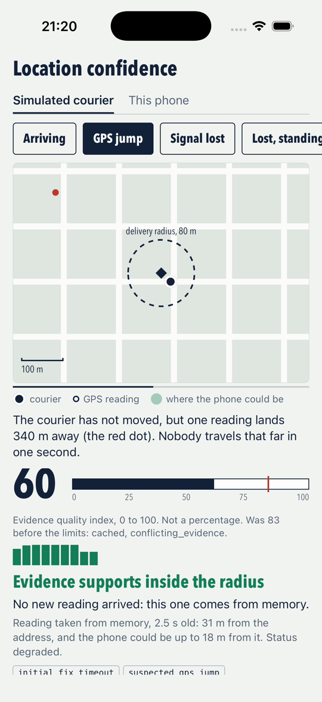

# react-native-location-confidence

Tells how good the location evidence is for one question: **"is this phone inside the delivery radius of this address?"**

A delivery app usually compares the last GPS reading with the address and stops there. That reading may be 40 seconds old, may be 200 m off, may be a one-second GPS glitch, or may come from a fake-GPS app. This library looks at those things and answers with a report:

- an **index from 0 to 100** that says how good the evidence is;
- what the evidence points to: **inside** the radius, **outside**, or **it cannot take a side**;
- the **reasons**, as short fixed codes.

It works while the app is on the screen, on Android and iOS, with the same engine on both (one C++ core behind a Kotlin and a Swift layer).

<p>
  
  
  
</p>

The screenshots come from the example app, which plays made-up situations against the real engine. Videos and the Android screenshots are in [docs/demo](docs/demo).

## What it is not

Read this before using it.

- **The index is not a percentage and not a probability.** `qualityScore: 78` does not mean "78% sure". It is a made-up scale that orders evidence from worse to better. Never show it with a `%` sign. `probabilityWithinRadius` exists in the report and is always `null`.
- **It is not proof of presence.** "Evidence supports inside" means the GPS evidence is compatible with the phone being there. It does not prove a person was at the door, and it does not prove a delivery happened.
- **It does not approve or refuse anything.** Your app decides what to do with the report. A common use is to ask for more proof (a photo, a code) when the evidence is weak.
- **It is not fraud detection.** It reports when the system marks a location as simulated. A location that is not marked proves nothing: a rooted phone or a modified system can hide the mark.
- **It does not work in the background.** There is no background tracking. When the app leaves the screen, whatever was running ends.

The numbers behind the index (weights, speeds, limits) are design choices, not calibrated measurements. They are listed below so you can judge them.

## Compatibility

Only what was really built and run is listed.

| | Built and run with |
|---|---|
| React Native | 0.88.1, New Architecture (TurboModule). The old architecture is not supported. |
| Android | compileSdk 36, minSdk 24, ABIs `arm64-v8a` and `x86_64`. Run on an Android 17 emulator (arm64), debug and release (R8 on). |
| iOS | Xcode 26.1.1, deployment target 15.1 (React Native's minimum). Run on the iOS 26.1 Simulator, debug and release. |
| Physical devices | Not tested yet. |

Expo Go is not supported: the library has native code, so it needs a development build (or any app you compile yourself).

On Android the phone's activity (standing still, walking...) is not read in this version, so `motion` is always `unsupported` there. On iOS it comes from Core Motion.

## Installation

```sh
npm install react-native-location-confidence
```

iOS:

```sh
cd ios && pod install
```

Rebuild the app after installing.

## Permissions

The library never asks for a permission by itself. Opening a session or evaluating never shows a dialog. The dialog appears only when your app calls `requestLocationPermission()` (or `requestMotionPermission()`).

### Android

The library declares no permission in its manifest. Add both to your app's `AndroidManifest.xml`:

```xml
<uses-permission android:name="android.permission.ACCESS_FINE_LOCATION" />
<uses-permission android:name="android.permission.ACCESS_COARSE_LOCATION" />
```

Since Android 12 the user chooses between the precise location and an approximate one, and an app must ask for the two together. With only the approximate one, the system blurs every reading on purpose (about 2 km of error): the report then says `permissionPrecision: 'approximate'` and the index never goes above 30.

Do not add `ACCESS_BACKGROUND_LOCATION`: the library does not use it.

Google Play services must be present (the library uses the fused location provider).

### iOS

Add to `Info.plist`:

```xml
<key>NSLocationWhenInUseUsageDescription</key>
<string>Say here why your app needs the location.</string>
<key>NSMotionUsageDescription</key>
<string>Say here why your app reads the phone's movement.</string>
```

`NSMotionUsageDescription` is only needed if you want the phone's activity to be used. Without it the library never touches Core Motion and `motion` is `unsupported`.

The library asks for "when in use" only. It never asks for "always".

## Usage

```ts
import { LocationConfidence } from 'react-native-location-confidence';

// Reads the permissions. Shows no dialog.
const authorization = await LocationConfidence.getAuthorization();

// Your app decides when to ask the user.
if (!authorization.locationGranted) {
  await LocationConfidence.requestLocationPermission();
}

const assessment = await LocationConfidence.evaluateProximity({
  destination: { latitude: -23.55052, longitude: -46.633308 },
  radiusMeters: 100,
});

assessment.qualityScore; // 75        an index from 0 to 100, not a percentage
assessment.evidenceRelation; // 'supports_inside' | 'supports_outside' | 'inconclusive'
assessment.status; // 'available' | 'degraded' | 'unavailable' | 'cancelled'
assessment.diagnostics.reasonCodes; // ['uncertainty_model_heuristic']
```

An evaluation turns the GPS on, waits for a reading that is good enough (12 seconds at most, by default), turns the GPS off and answers. It always answers, and always once.

### With a session

A single reading has nothing to confirm it, so its index stops at 75. A session remembers the last 10 readings, which lets later evaluations compare readings with each other, notice a GPS jump, and still answer when the GPS is slow.

```ts
const session = await LocationConfidence.startSession();

try {
  const assessment = await LocationConfidence.evaluateProximity({
    sessionId: session.id,
    destination,
    radiusMeters: 100,
  });
} finally {
  // Forgets the readings. Call it when the delivery ends or the user logs out.
  await LocationConfidence.stopSession(session.id);
}
```

By default a session only remembers the readings its own evaluations obtained, and opening it turns nothing on. To have readings ready before the first evaluation, ask the session to keep collecting while the app is on the screen:

```ts
const session = await LocationConfidence.startSession({
  collectionMode: 'foreground_monitoring',
  monitoringIntervalMs: 5000,
});

session.monitoring; // 'active', or 'blocked' with the reason in session.reasonCodes
```

Collecting uses more battery, needs the location permission, stops by itself after `maxMonitoringDurationMs` (15 minutes by default, 1 hour at most) and stops when the app leaves the screen. It does not start again by itself: open a new session.

### Cancelling

```ts
const controller = new AbortController();

const pending = LocationConfidence.evaluateProximity({
  destination,
  radiusMeters: 100,
  signal: controller.signal,
});

controller.abort();

const assessment = await pending;
assessment.status; // 'cancelled'
```

A cancelled evaluation still resolves, with `status: 'cancelled'`. It is not an error.

## API

```ts
LocationConfidence.getCapabilities(): Promise<Capabilities>
LocationConfidence.getAuthorization(): Promise<Authorization>
LocationConfidence.requestLocationPermission(): Promise<Authorization>
LocationConfidence.requestMotionPermission(): Promise<Authorization>

LocationConfidence.startSession(options?): Promise<Session>
LocationConfidence.clearHistory(sessionId): Promise<void>
LocationConfidence.stopSession(sessionId): Promise<void>

LocationConfidence.evaluateProximity(request): Promise<Assessment>

LocationConfidence.simulation // see "Simulation"
```

`getCapabilities()` and `getAuthorization()` only read. They show no dialog and never turn the GPS on.

### Options of an evaluation

Every measure carries its unit in the name: `Meters`, `Ms` (milliseconds), `Mps` (meters per second).

| Option | Default | Allowed | Meaning |
|---|---|---|---|
| `totalDeadlineMs` | 12000 | 1000 to 60000 | The whole evaluation never takes longer than this. |
| `initialFixBudgetMs` | 4500 | 0 to the total | How long the first attempt waits. |
| `recoveryWindowMs` | 7000 | 0 to 20000 | How long the extra time lasts. 0: no extra time. |
| `maxFreshAgeMs` | 10000 | 0 to 120000 | A reading up to this old counts as obtained now. |
| `maxFallbackAgeMs` | 60000 | `maxFreshAgeMs` to 120000 | A reading older than this is never used. |
| `maxHorizontalAccuracyMeters` | 50 | above 0 | Above this GPS error the answer is only `degraded`. |
| `maxPlausibleSpeedMps` | 45 | above 0 | The fastest a courier is assumed to move (45 m/s is 162 km/h). |
| `enableMotionAssistance` | true | | Use the phone's activity when it is available. |
| `allowHistoricalFallback` | true | | Allow an answer from a reading the session remembers. |
| `mockLocationPolicy` | `'zero_score'` | or `'flag_only'` | What to do with a reading the system marked as simulated. |

`radiusMeters` must be above 0 and at most 100000. Latitude goes from -90 to 90 and longitude from -180 to 180.

### The report

| Field | Meaning |
|---|---|
| `status` | `available`: a reading obtained now, precise enough, nothing suspicious. `degraded`: there is a reading, but something about it is weak. `unavailable`: no usable reading. `cancelled`. |
| `source` | `fresh`: obtained in the first attempt. `recovered`: obtained in the extra time. `cached`: remembered by the session. `unavailable`. |
| `evidenceRelation` | `supports_inside`, `supports_outside` or `inconclusive`. |
| `qualityScore` | The index, a whole number from 0 to 100. |
| `probabilityWithinRadius` | Always `null`. |
| `measuredPosition` | The reading that was used, exactly as the phone measured it. The library never predicts or invents a position. `null` when there is none. |
| `distanceMeters` | From that reading to the address, in a straight line. |
| `horizontalAccuracyMeters` | The phone's own estimate of the error of the reading. |
| `effectiveUncertaintyMeters` | How far the phone could be from the reading right now: its error plus the distance it could have moved since. A cautious bound, not a statistical interval. |
| `locationAgeMs` | How old the reading is. |
| `ageReliability` | `monotonic`: measured on a clock that cannot be changed (Android). `estimated`: worked out from the wall clock (iOS). |
| `permissionPrecision` | `precise`, `approximate` or `unknown`. |
| `motion` | What is known about the activity of the phone, not of the person. |
| `scoreBreakdown` | The four grades, the score before the limits, and the limits that applied. |
| `diagnostics` | `reasonCodes`, the steps of the evaluation, counts of readings, the duration, and `simulatedLocationReported`. |

`diagnostics.simulatedLocationReported` is `true` when the system marked the reading as simulated, `false` when it did not (which proves nothing) and `null` when the system said nothing.

### Errors

Only programming mistakes and a broken installation are thrown. No permission, GPS off, timeout, cancel and "app left the screen" are reports, not errors.

| Error | `code` | When |
|---|---|---|
| `InvalidArgumentError` | `invalid_argument` | An argument makes no sense. `error.argument` names it. Nothing native was called. |
| `NativeModuleError` | `native_module_missing` | The native part is not in the app: rebuild it. |
| `NativeModuleError` | `native_version_mismatch` | The native code is from another version of the library: rebuild the app. |
| `NativeModuleError` | `platform_unsupported` | The engine could not be started on this device. |
| `NativeModuleError` | `missing_usage_description` | iOS: the text in `Info.plist` is missing. |
| `NativeModuleError` | `no_activity` | Android: there is no screen on which to show the permission dialog. |
| `NativeModuleError` | `native_internal_error` | The native side failed in a way that was not expected. |
| `LocationConfidenceError` | `busy` | More than 8 sessions are open. |

## How the answer is built

### Where the phone could be

A GPS reading says where the phone was, not where it is. For each reading the engine works out how far the phone could have moved since, and takes the smallest of the answers it can calculate:

1. From the phone's activity, when it is known: standing still 0.5 m/s, walking 3 m/s, running 8 m/s, cycling 12 m/s.
2. From the speed the GPS reported with the reading: `(speed + 2 x its error) x seconds + 2.5 x seconds² / 2`.
3. Otherwise the fastest speed allowed (`maxPlausibleSpeedMps`, 45 m/s by default) times the seconds.

That distance plus the GPS error is `effectiveUncertaintyMeters`. With nothing known about the movement, it grows by 45 m every second: two seconds of silence are enough for a 100 m radius to become "cannot take a side". That is on purpose.

### Inside, outside, or neither

With `d` the distance from the reading to the address, `u` the uncertainty above and `r` the radius:

- `d + u <= r`: `supports_inside` (inside even in the worst case);
- `d - u > r`: `supports_outside` (outside even in the best case);
- anything else: `inconclusive`.

A reading that looks like a GPS jump, or that the system marked as simulated (with the default policy), is always `inconclusive`.

### The index

Four grades from 0 to 1 are blended:

| Grade | Weight | 1.0 when | 0 when |
|---|---|---|---|
| Accuracy | 40% | the GPS error is 0 m | it is 100 m or more |
| Freshness | 25% | the reading was taken now | it is 60 s old or more |
| Movement | 20% | the phone could not have moved | it could have moved 100 m or more |
| Consistency | 15% | three or more readings agree (two: 0.8, one: 0.6) | readings contradict each other (0.3) |

Then limits are applied. When several apply, the lowest wins:

| Limit | The index never goes above | When |
|---|---|---|
| `single_fix` | 75 | Only one reading: nothing confirms it. |
| `conflicting_evidence` | 75 | A remembered reading contradicts the one used. |
| `cached` | 60 | The reading comes from memory, not from the GPS just now. |
| `unknown_movement_not_fresh` | 40 | From memory, and nothing tells whether the phone moved. |
| `uncertainty_at_least_100m` | 35 | The phone could be 100 m or more from the reading. |
| `approximate_permission` | 30 | Only the approximate location is allowed. |
| `suspected_jump` | 20 | The reading looks like a GPS glitch. |
| `uncertainty_at_least_300m` | 15 | The phone could be 300 m or more from the reading. |
| `mock_location` | 0 | Marked as simulated, with the `zero_score` policy. |
| `no_candidate` | 0 | There is no reading. |

The limits that applied are in `scoreBreakdown.appliedCaps`, and the blend before them in `scoreBreakdown.rawScore`.

A high index with `supports_outside` is normal: it means the evidence that the phone is outside is good.

### Reason codes

`diagnostics.reasonCodes` explains the answer. The codes are stable texts. The ones you will meet most:

| Code | Meaning |
|---|---|
| `permission_not_determined`, `permission_denied`, `permission_restricted` | The location cannot be read. |
| `location_services_disabled` | Location is turned off on the phone. |
| `play_services_unavailable` | Android: Google Play services are missing. |
| `precision_reduced` | Only the approximate location is allowed. |
| `initial_fix_timeout`, `recovery_window_timeout`, `overall_deadline_reached` | No reading good enough arrived in that step. |
| `no_usable_fix`, `history_empty` | There was nothing to answer with. |
| `location_stale` | The reading used is older than `maxFreshAgeMs`. |
| `location_low_accuracy` | Its GPS error is above `maxHorizontalAccuracyMeters`. |
| `history_only_inconclusive` | Only a remembered reading was left, and it cannot take a side. |
| `suspected_gps_jump` | Readings in memory contradict each other. |
| `possible_mock_location` | The system marked the reading as simulated. |
| `motion_unavailable`, `motion_permission_denied` | The phone's activity was not used. |
| `request_cancelled`, `app_backgrounded`, `session_stopped` | Why the evaluation was cancelled. |
| `unknown_session` | That session id is not open. |
| `busy` | Too many evaluations are running (16 at most, 4 per session). |
| `monitoring_duration_reached` | The session stopped collecting because its time was over. |
| `uncertainty_model_heuristic` | Always present with a reading: the distances come from assumed speeds. |
| `simulated_location_source` | The readings came from the simulation below, not from the GPS. |

## Simulation

For demos and tests your app can replace the GPS with readings of its own:

```ts
await LocationConfidence.simulation.enable();

const pending = LocationConfidence.evaluateProximity({ destination, radiusMeters: 100 });

await LocationConfidence.simulation.pushReadings([
  { latitude: -23.5503, longitude: -46.6333, accuracyMeters: 8 },
]);
await LocationConfidence.simulation.setPhoneActivity('stationary');

const assessment = await pending;

await LocationConfidence.simulation.disable();
```

While it is enabled the real GPS is never used and no permission is needed. Every report then carries `simulated_location_source`, so a simulated answer cannot be mistaken for a real one. The engine runs exactly as it does with the real GPS.

## Platform notes

**Android**

- A denied permission and a permission that was never asked look the same to an app. `getAuthorization()` says `denied` only after your app asked during this run; before that it says `not_determined`.
- Android tells an app that it left the screen about 0.7 s after it happened. The GPS is turned off then.
- A location coming from a mock-location app is marked by the system and reported as `possible_mock_location`.

**iOS**

- iOS has no "one reading every N milliseconds" setting. It delivers at its own pace and `monitoringIntervalMs` only decides how many of those readings a collecting session keeps.
- iOS stamps a location with the wall clock, so `ageReliability` is `estimated`.
- In the Simulator, and when a GPX file is used in Xcode, iOS marks every location as simulated by software. With the default policy the index is then 0. Use `mockLocationPolicy: 'flag_only'` or the simulation above while developing.

## Privacy

- No network. The library sends nothing anywhere.
- No storage. Readings live in memory only, at most 10 per session, and are forgotten when the session is stopped, when the location permission is taken away, or when the app closes.
- No logs with coordinates.
- Reason codes never contain coordinates, so they are safe to put in a bug report.
- The iOS pod ships a privacy manifest (`PrivacyInfo.xcprivacy`).

## Troubleshooting

| What you see | What to do |
|---|---|
| `native_module_missing` | Rebuild the app. On iOS run `pod install` first. Expo Go cannot load the library. |
| `native_version_mismatch` | The JavaScript and the native code are from different versions: rebuild the app. |
| `status: 'unavailable'` with `permission_not_determined` | Call `requestLocationPermission()` first. Evaluating never asks. |
| The index is always 75 | A single reading stops there. Use a session. |
| The index is 0 in the iOS Simulator | The Simulator's locations are marked as simulated. See the iOS notes. |
| `inconclusive` a few seconds after a good reading | Nothing told the engine how the phone moved, so the area where it could be grew past the radius. A session, the phone's activity (iOS), or a lower `maxPlausibleSpeedMps` keep it smaller. |
| A collecting session stopped | It stops when the app leaves the screen and after `maxMonitoringDurationMs`. Open a new one. |

## Example app

```sh
yarn
yarn example android   # or: yarn example ios
```

The first screen plays six made-up situations against the real engine: a courier arriving, a GPS jump, the signal lost, the signal lost while the phone reports it stands still, a fake-GPS app, and approximate location only. The second screen uses the real GPS of the phone.

## Development

| What | Command |
|---|---|
| Engine tests (C++, on your computer) | `cmake -S cpp -B build/cpp -DLCE_BUILD_TESTS=ON && cmake --build build/cpp && ./build/cpp/lce_tests` |
| TypeScript tests | `yarn test` |
| Types and lint | `yarn typecheck && yarn lint` |
| Kotlin tests on your computer | `cd example/android && ./gradlew :react-native-location-confidence:testDebugUnitTest` |
| The same Kotlin tests on a phone or an emulator | `cd example/android && ./gradlew :react-native-location-confidence:connectedDebugAndroidTest` |
| Swift tests on a Mac | `swift test` |

The engine is in `cpp/`, and each of its files starts with a picture of the order of the calls and a worked example. The reports of each phase of the project (in Portuguese) are in `docs/`.

## License

MIT
